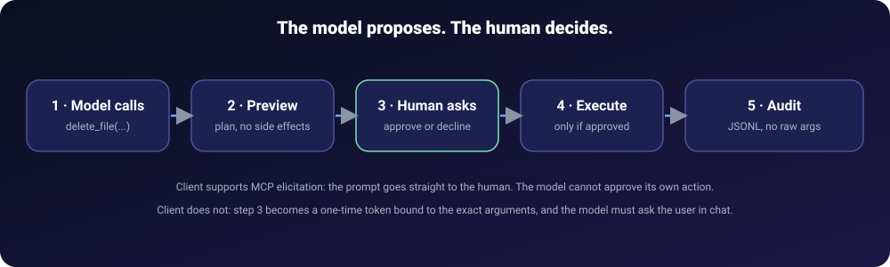
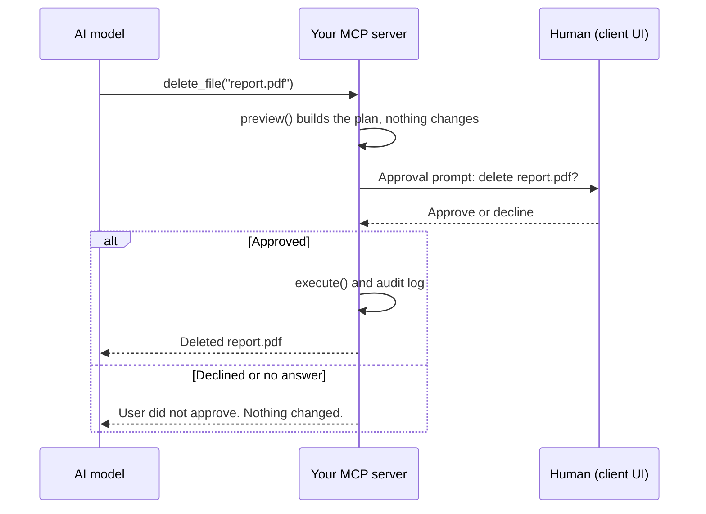
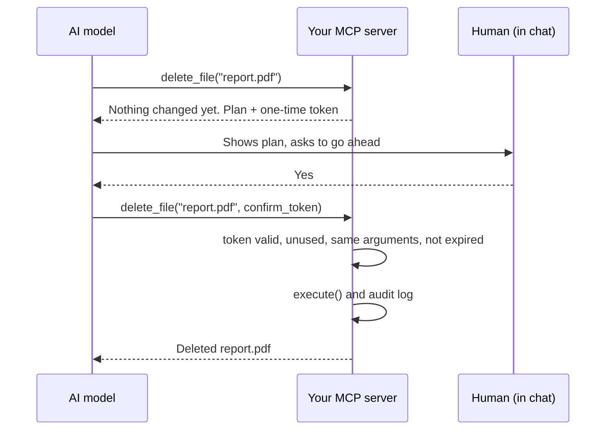
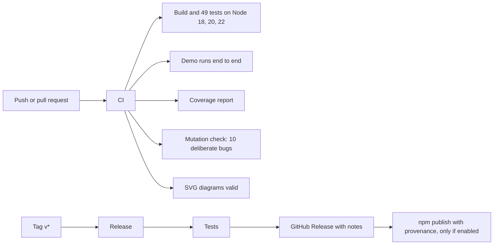

<p align="center">
  
</p>

<p align="center">
  <a href="https://github.com/techsaurabh-394/mcp-safe-actions/actions/workflows/ci.yml"></a>
  
  
  
  <a href="LICENSE"></a>
</p>

<p align="center">
  <a href="https://github.com/techsaurabh-394/mcp-safe-actions"></a>
  <b><a href="https://github.com/techsaurabh-394/mcp-safe-actions">Star this repo</a></b> if it saves you from a bad tool call &nbsp;·&nbsp;
  <a href="https://buymeacoffee.com/saurabhdev"></a>
</p>

# mcp-safe-actions: human approval for destructive MCP tools

**Your AI agent should not be able to delete a file, send an email or drop a table just because it decided to.**

`mcp-safe-actions` is a small TypeScript library for people who **build MCP servers** (Model Context Protocol). Wrap a dangerous tool once and it **does nothing until a human approves**. The model cannot approve its own action.

<p align="center">
  
</p>

## Why you might want this
- A prompt-injected or confused model can call `delete_file("../../important")`. "Please ask first" in a prompt is a request, not a control.
- Approval in the **client** UI is the right place for a human decision, and MCP now has a feature for it (elicitation). Not every client supports it yet, so you also need a safe fallback.
- You want a **log** of what was previewed, approved, refused and run, without leaking secrets.

This library packages that pattern once, with a test suite that proves the safety rules, instead of rebuilding it in every server.

## Add it to your MCP server in 4 steps

### 1. Install
```bash
npm install github:techsaurabh-394/mcp-safe-actions
```
Once it is published to npm: `npm install mcp-safe-actions`.
You also need `@modelcontextprotocol/sdk` (1.17+) and `zod` (you probably have both). Node 18+.

### 2. Wrap your dangerous tool
Replace `server.registerTool(...)` with `registerConfirmedTool(server, ...)` and split the work into **preview** (describe, don't change anything) and **execute** (runs after approval):

```ts
import { rmSync, statSync } from "node:fs";
import { McpServer } from "@modelcontextprotocol/sdk/server/mcp.js";
import { StdioServerTransport } from "@modelcontextprotocol/sdk/server/stdio.js";
import { z } from "zod";
import { registerConfirmedTool, fileAudit } from "mcp-safe-actions";

const server = new McpServer({ name: "files", version: "1.0.0" });

registerConfirmedTool(server, {
  name: "delete_file",
  description: "Permanently delete one file.",
  inputSchema: { path: z.string() },

  // What WILL happen. Must not change anything. Be specific.
  preview: ({ path }) => ({
    summary: `Permanently delete "${path}" (${statSync(path).size} bytes)`,
    details: ["This cannot be undone."],
  }),

  // Runs only after the user approved. Re-check anything that could have changed.
  execute: ({ path }) => {
    rmSync(path);
    return { content: [{ type: "text", text: `Deleted ${path}` }] };
  },

  audit: fileAudit("./audit.jsonl"), // optional
});

await server.connect(new StdioServerTransport());
```
The tool is listed with `destructiveHint: true` and a description telling the model to wait for the user.

### 3. Run the demo and the tests
```bash
git clone https://github.com/techsaurabh-394/mcp-safe-actions.git
cd mcp-safe-actions
npm install
npm run demo      # prints both approval flows
npm test          # 49 tests
```

### 4. Connect it to an MCP client
**Claude Desktop** (`claude_desktop_config.json`), using the included example server and a throwaway folder:
```json
{
  "mcpServers": {
    "files": {
      "command": "node",
      "args": ["/absolute/path/to/mcp-safe-actions/dist/examples/files-server.js"],
      "env": { "FILES_DIR": "/absolute/path/to/test-folder", "AUDIT_LOG": "/absolute/path/to/audit.jsonl" }
    }
  }
}
```
**Claude Code:** `claude mcp add files -- node /absolute/path/to/mcp-safe-actions/dist/examples/files-server.js`

Run `npm run build` first. Then ask the assistant to delete a file in the test folder. You should see either an **approval prompt** (clients with elicitation) or a **preview with a token** and a question from the assistant (clients without). The file must still exist until you say yes.

## How it works



**Client supports elicitation (best case):**


**Client without elicitation (token fallback):**


### Decision table
| Situation | Result |
|---|---|
| Elicitation accepted and the box is ticked | `execute()` runs |
| Declined, cancelled, unticked, timed out or errored | Nothing runs |
| `mode: "elicit"` and the client has no prompts | Refused, no token issued |
| Token flow, no token | Preview plus one-time token, nothing runs |
| Token flow, valid token and identical arguments | `execute()` runs once |
| Reused, expired, unknown, or for other arguments or another tool | Nothing runs, reason returned |

### Modes
| `mode` | Behaviour | Use when |
|---|---|---|
| `"auto"` (default) | Elicitation if supported, otherwise token | Most servers |
| `"elicit"` | Elicitation only | Actions that **must** have a human gate |
| `"token"` | Always the token flow | Testing, or by preference |

## Proof it works: tests that try to break it
| | |
|---|---|
| **49 tests** | Unit, end-to-end (a real MCP client and server in memory), property tests (300 random argument objects), and **real stdio tests** that spawn the example server as a child process |
| **100% line coverage** of the library (`src/`), 96.8% to 100% of branches | `npm run coverage` |
| **10 deliberate bugs, all caught** | `npm run mutation` breaks the code on purpose (token reusable, approval skipped on error, secrets in the log, ...) and fails if the tests don't notice |

What the tests prove, among other things: a declined prompt never runs the action; a model-supplied token cannot skip the human prompt; tokens are single-use, expire, and only work for the same tool and arguments; two simultaneous uses of one token run the action exactly once; a prompt that times out or crashes fails closed; secret argument values never reach the audit log; the example server blocks path traversal and symlink escapes.

Details and an honest note about a weak test the mutation check caught: [docs/TESTING.md](docs/TESTING.md).

## Guarantees, and what it does NOT guarantee
| It guarantees | How |
|---|---|
| Nothing runs before approval | `execute()` is reachable only after an accepted prompt or a valid token |
| The model can't self-approve (elicitation) | The prompt goes to the human through the client, not through the model |
| Tokens are single-use, bound to tool and exact arguments, and expire | Checked server-side |
| Failures fail closed | Errors and timeouts never fall through to execution |
| Audit without leaking secrets | Logs your summary and a hash of the arguments, never the raw arguments |

Be clear-eyed:
- **Token mode is a speed bump, not proof of a human.** A model could call twice without asking. For actions that need a real human gate, use `mode: "elicit"`.
- **Your preview must be truthful**, and `execute()` should re-check state that may have changed since.
- **It doesn't sandbox your server.** It gates the tools you wrap. Keep least-privilege credentials and validate inputs.
- **Elicitation depends on the client.** Support differs by client and version.

Full threat model: [docs/SECURITY-MODEL.md](docs/SECURITY-MODEL.md).

## API
```ts
registerConfirmedTool(server, {
  name, title?, description, inputSchema,     // like server.registerTool
  preview(args) => { summary, details? },     // no side effects
  execute(args) => CallToolResult,            // after approval
  risk?: "destructive" | "write",             // default "destructive" (sets annotations)
  mode?: "auto" | "elicit" | "token",         // default "auto"
  approvalTimeoutMs?: number,                 // default 5 minutes; a timeout means "not approved"
  store?: new ApprovalStore({ ttlMs, maxPending }),
  audit?: (event) => void | fileAudit(path),
  annotations?,                               // override tool annotations
});
```
`confirm_token` is a reserved input name. More in [docs/USAGE.md](docs/USAGE.md), including how to test your own tools with an in-memory client.

## GitHub Actions in this repo

| Workflow | Runs when | Does |
|---|---|---|
| `ci.yml` | every push to `main` and every pull request | Build, tests on Node 18/20/22, demo, `npm pack` check, coverage, mutation check, SVG validation |
| `release.yml` | you push a tag like `v1.1.0` | Tests, GitHub Release, and npm publish if you enabled it |
| `dependabot.yml` | monthly | Opens update PRs for npm packages and Actions |

**Add the same safety net to your own server's repo:**
```yaml
# .github/workflows/ci.yml
name: CI
on: [push, pull_request]
jobs:
  test:
    runs-on: ubuntu-latest
    steps:
      - uses: actions/checkout@v4
      - uses: actions/setup-node@v4
        with: { node-version: 22, cache: npm }
      - run: npm ci
      - run: npm test   # include a test that the dangerous tool does NOT run without approval
```
`test/helpers.ts` in this repo shows how to simulate a human who approves, declines, or never answers.

## Roadmap
- [x] Elicitation flow, token fallback, timeouts, audit log, annotations
- [x] 49 tests, 100% line coverage, mutation check, real stdio tests
- [ ] Publish to npm
- [ ] Approval channel hooks (Slack, webhook) for headless servers
- [ ] Policy: auto-approve low-risk calls, always ask for high-risk ones
- [ ] Python version for FastMCP servers

## Contributing
Issues and PRs welcome: [CONTRIBUTING.md](CONTRIBUTING.md). Any change to approval logic needs a test showing the action does **not** run without approval, and `npm run mutation` must still pass.

## Star history
[](https://star-history.com/#techsaurabh-394/mcp-safe-actions&Date)

## Support this project
If this helped you ship a safer agent, please <a href="https://github.com/techsaurabh-394/mcp-safe-actions"> star the repo</a>, share it, or buy me a coffee:

<a href="https://buymeacoffee.com/saurabhdev"></a>

## License
MIT. See [LICENSE](LICENSE). Copyright (c) 2026 Saurabh Pathak.

---

<p align="center">
  <b>Saurabh Pathak</b> · AI Engineer &amp; Full-Stack Developer<br/>
  <a href="https://github.com/techsaurabh-394">GitHub</a> ·
  <a href="https://www.linkedin.com/in/tech-saurabh/">LinkedIn</a> ·
  <a href="https://mernstackdev.com">Blog</a> ·
  <a href="mailto:saurabhpathak394@gmail.com">saurabhpathak394@gmail.com</a>
</p>
